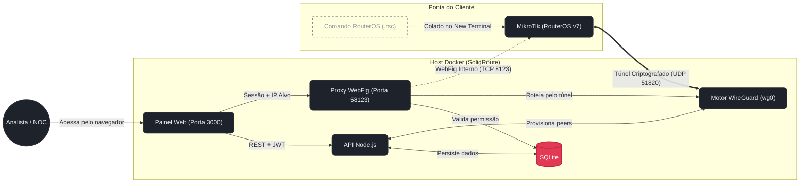

# SolidRoute

Gerência remota e provisionamento em segundos para frotas de roteadores MikroTik.

Quem opera NOC, provedor ou atende clientes corporativos com MikroTik conhece bem o problema: dezenas de RBs espalhadas atrás de CGNAT, links com IP dinâmico ou conexões via satélite onde você não tem IP público para chegar no equipamento. Configurar túnel por túnel na mão (gerando par de chaves, calculando IP, criando rota, subindo regra de firewall e agendando script de DDNS) consome tempo da equipe e abre margem para erro humano.

O **SolidRoute** resolve essa operação em uma única tela. Você informa a identificação do equipamento, a plataforma cria o peer no servidor WireGuard automaticamente e já entrega a linha de comando pronta para colar no terminal do RouterOS. Assim que o roteador conecta, toda a sua equipe passa a monitorar o status em tempo real e consegue abrir o **WebFig** direto pelo navegador em um clique, sem precisar instalar VPN na máquina de cada analista.

---

## O que a plataforma entrega na prática

* **Provisionamento sem trabalho manual:** Basta digitar o nome da RB. O backend conversa com o motor WireGuard, reserva o IP da VPN, extrai as chaves e monta o script `.rsc` completo. Se algo falhar no meio do caminho, o sistema faz o rollback sozinho para não deixar peers órfãos.
* **WebFig direto no navegador (Multi-operador):** Um proxy reverso dedicado na porta `58123` permite que vários analistas abram o WebFig de diferentes MikroTiks ao mesmo tempo, direto pelo browser. O acesso exige sessão autenticada no painel e bloqueia qualquer tentativa de roteamento para IPs fora da base cadastrada.
* **Monitoramento vivo da base:** A listagem principal cruza os registros locais com os últimos *handshakes* do túnel para mostrar quais unidades estão realmente ativas, destacando imediatamente equipamentos sem comunicação.
* **Importação seletiva de túneis:** Já tem um servidor WireGuard rodando com clientes antigos? O recurso de sincronização lê os peers existentes e deixa você selecionar apenas o que for roteador antes de trazer para o painel.
* **Controle de acesso para a equipe:** Divisão clara entre perfis de **Administrador** e **Operador**, proteção contra tentativas de força bruta no login e gestão completa de senhas.

---

## Como funciona o fluxo



---

## Estrutura do Projeto

O repositório segue uma organização limpa dividida por aplicação:

```text
SolidRoute/
├── apps/
│   ├── api/              # Servidor Node.js, API REST, banco SQLite e Proxy WebFig
│   └── web/              # Interface em React, Vite e TailwindCSS (tema escuro inspirado no WinBox 4)
├── docs/
│   └── ARCHITECTURE.md   # Detalhamento técnico de rede, segurança e proxy
├── .env.example          # Modelo de configuração de ambiente
├── docker-compose.yml    # Orquestração completa (Portal + Servidor WireGuard)
└── Dockerfile            # Build multi-stage otimizado para produção
```

---

## Subindo em Produção

Você só precisa de um servidor Linux com **Docker** e **Docker Compose** instalados.

### 1. Baixe o projeto e crie o arquivo de ambiente

```bash
git clone https://github.com/Rafaelzyzy/SolidRoute.git
cd SolidRoute
cp .env.example .env
```

### 2. Configure o seu endereço público e senha no `.env`

Abra o arquivo `.env` e ajuste o `WG_HOST` com o IP público ou DDNS do seu servidor (é para esse endereço que os MikroTiks vão apontar ao fechar o túnel):

```env
WG_HOST=vpn.suaempresa.com.br
WG_DEFAULT_ADDRESS=10.8.0.x
WG_PASSWORD=sua-senha-forte
WG_PASSWORD_HASH='$2b$12$...'
JWT_SECRET=
ADMIN_DEFAULT_EMAIL=admin@solidroute.com
ADMIN_DEFAULT_PASSWORD=admin123
```

Para gerar o hash bcrypt da sua senha (`WG_PASSWORD_HASH`), basta rodar o comando abaixo e colar o resultado mantendo as **aspas simples**:

```bash
docker run --rm ghcr.io/wg-easy/wg-easy:14 wgpw 'sua-senha-forte'
```

> **Nota sobre a chave `JWT_SECRET`:** Se você deixá-la em branco no `.env`, o próprio SolidRoute cria automaticamente uma chave criptográfica exclusiva de 96 caracteres no primeiro boot e a salva na pasta persistente `./data/solidroute/.jwt_secret`.

### 3. Inicie os serviços

```bash
docker compose up -d --build
```

### Portas de Rede

| Porta | Protocolo | Finalidade |
|---|---|---|
| `51820` | UDP | Entrada do túnel WireGuard (liberar no firewall/NAT do servidor) |
| `3000` | TCP | Painel administrativo do SolidRoute |
| `58123` | TCP | Proxy autenticado para abertura do WebFig |
| `51821` | TCP | API interna do WG-Easy (travada em `127.0.0.1`, inacessível externamente) |

### Primeiro Login

Acesse `http://IP-DO-SERVIDOR:3000` com as credenciais iniciais definidas no `.env` (por padrão `admin@solidroute.com` e senha `admin123`). Logo após entrar, use a opção **Alterar Minha Senha** no canto inferior esquerdo do menu para definir a sua senha definitiva.

---

## O que o comando gerado faz no MikroTik

Ao adotar um equipamento, o código gerado cria e executa um script chamado `setup-solidroute` no RouterOS (compatível com RouterOS v7+). Ele pode ser executado quantas vezes for necessário: se você colar mais de uma vez, ele apenas atualiza os parâmetros sem duplicar regras:

1. **Interface `wg-solidroute`:** Cria a interface WireGuard com MTU `1420` e aplica a chave privada exclusiva daquela unidade.
2. **Endereçamento e Rota:** Atribui o IP da VPN na interface e adiciona a rota para a sub-rede do túnel.
3. **Peer do Servidor:** Configura chave pública, *preshared-key*, *endpoint* e `persistent-keepalive=25s` para atravessar NAT/CGNAT sem perder a sessão.
4. **Regras de Firewall no Topo:** Insere no topo da cadeia `input` (restrito exclusivamente ao tráfego que entra pela interface `wg-solidroute`) a liberação das portas `8291/tcp` (Winbox) e `8123/tcp` (WebFig), evitando que alguma regra de `drop` geral do cliente bloqueie a gerência.
5. **Scheduler de DDNS:** Cria uma tarefa agendada (`SolidRoute-DDNS`) que roda a cada 1 hora atualizando a resolução do hostname do servidor, garantindo reconexão automática caso o seu IP público mude.

---

## Backup e Persistência

Toda a operação fica salva na pasta `./data` na raiz do projeto:
* `./data/solidroute/`: Banco de dados SQLite (`solidroute.db`) e chave de sessão.
* `./data/wg-easy/`: Configurações e chaves das interfaces WireGuard (`wg0.conf` e `wg0.json`).

Para migrar de servidor ou fazer backup, basta copiar a pasta `./data` e o arquivo `.env`.

---

## Licença

O **SolidRoute** adota um modelo de licenciamento duplo (**Dual License**):

* **Uso Pessoal, Estudo e Homologação (Gratuito):** Liberado gratuitamente para estudantes, entusiastas e testes em laboratório pessoal sem fins lucrativos.
* **Uso em Empresas e Provedores (Licença Comercial):** O uso em ambiente de produção corporativa, provedores de internet (ISPs), operações de NOC, consultorias ou comercialização como serviço (SaaS) exige a contratação de uma licença comercial junto ao autor.

Consulte o arquivo [LICENSE](LICENSE) para os termos completos ou entre em contato via [GitHub (@Rafaelzyzy)](https://github.com/Rafaelzyzy) para licenciamento empresarial.

